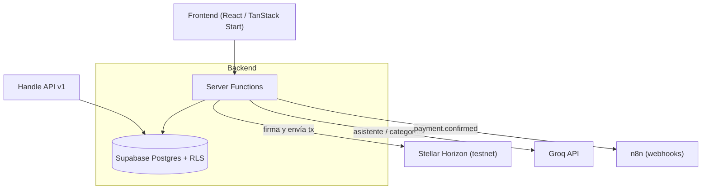

# Handle

**El ERP ligero para PyMEs de LATAM — con pagos on-chain e IA.**

Gestiona clientes, colaboradores, finanzas y pagos a proveedores en una sola plataforma, potenciada por agentes de IA (Groq) y rieles de pago en stablecoin sobre Stellar.

`Hecho para PyMEs de México` · `Web3 invisible` · `IA nativa`

---

## 🎯 ¿Qué es Handle?

Las PyMEs en México y LATAM operan con herramientas fragmentadas (Excel, WhatsApp, apps de banco, nóminas en papel) y no tienen presupuesto para ERPs caros ni para personal administrativo extenso. **Handle** es el sistema operativo administrativo de la PyME latina: una sola plataforma que unifica la gestión *end-to-end* del negocio, abarata y acelera los pagos a proveedores con stablecoins, y automatiza tareas repetitivas con IA.

Este repositorio es el MVP construido para un **hackathon**.

## ✨ Módulos

| Módulo | Qué hace |
|---|---|
| 📊 **Finanzas** | Ingresos/egresos, dashboard de flujo de caja, saldos por cuenta, formato MXN. Asistente de IA que responde preguntas sobre tus finanzas. |
| 💸 **Pagos a proveedores (on-chain)** | Órdenes de pago liquidadas **en Stellar testnet** (XLM). Cuenta custodia por organización, cotización MXN→token, hash verificable en el explorer y registro automático del egreso. |
| 👥 **CRM / Clientes** | Cartera de clientes con contactos, estado de cuenta y saldos por cobrar. |
| 🧑‍💼 **RH / Colaboradores** | Directorio de personas (tipo Buk). Nómina y vacaciones en roadmap. |
| 🤖 **IA (Groq)** | Asistente financiero en lenguaje natural y auto-categorización de transacciones. |
| 🔗 **Automatización (n8n)** | Webhook `payment.confirmed` al confirmarse un pago, para disparar flujos externos. |
| 🧩 **API para desarrolladores** | API REST (`/api/v1/...`) con API keys para que otras empresas integren Handle en sus flujos. |

## 🛠️ Stack técnico

- **Frontend:** React + TanStack Start + TypeScript + Tailwind CSS + shadcn/ui
- **Backend:** Supabase (PostgreSQL + Auth + RLS) y **server functions** de TanStack Start
- **Blockchain:** Stellar (testnet) vía `@stellar/stellar-base` + Horizon
- **Stablecoin / ramp:** abstracción `QuoteProvider` (MXN→token), lista para **Etherfuse** (MXNe/USDC)
- **IA:** Groq (API OpenAI-compatible) con selección automática de modelo disponible
- **Automatización:** n8n (webhooks)
- **Construido con:** Lovable

## 🏗️ Arquitectura

**Seguridad:** Row Level Security por `org_id` en todas las tablas (multi-tenant). Las llaves secretas (cuenta custodia Stellar, API keys de proveedores externos) viven **solo del lado servidor**, nunca en el cliente.

## 📦 Modelo de datos (principal)

`organizations` · `profiles` · `clients` · `client_contacts` · `employees` · `leave_requests` · `accounts` · `transactions` · `suppliers` · `payments` · `org_wallets` · `agent_runs` · `api_keys`

## 🔑 Variables de entorno / secretos

Configurar en el proyecto (Supabase / Lovable secrets):

| Secreto | Descripción |
|---|---|
| `GROQ_API_KEY` | Clave de Groq (console.groq.com) para el asistente y la categorización de IA |
| `N8N_WEBHOOK_URL` | URL de producción del webhook de n8n (opcional; fail-safe si no está) |
| `GROQ_MODEL` | *(Opcional)* modelo de Groq a usar; por defecto se elige uno disponible para la clave |

> La cotización MXN→token usa un stub configurable (p. ej. 1 XLM = 6 MXN) con un `TODO` marcado para integrar **Etherfuse** cuando se tenga la API key sandbox.

## 🚀 Flujo estrella (demo)

1. Crear orden de pago a proveedor (monto en MXN) → se cotiza a token.
2. **Confirmar y enviar** → transacción real firmada y enviada en **Stellar testnet**.
3. Ver el pago **Confirmado** con hash y enlace al explorer.
4. El egreso se registra automáticamente en Finanzas y el saldo se actualiza.
5. Se dispara el webhook `payment.confirmed` hacia n8n.

> 💡 Para el demo: usa el botón **"Generar wallet de prueba"** en un proveedor para crear una cuenta testnet real y fondeada antes de pagarle.

## 🗺️ Roadmap

- Integración real de **Etherfuse** (MXNe/USDC) para on/off-ramp
- Login con **Privy** (onboarding sin fricción)
- Voz con **ElevenLabs** y gestión de tareas con **Linear**
- Nómina con timbrado CFDI (SAT), conciliación bancaria, mainnet y app móvil
- Endpoints `POST /api/v1/payments` y `GET /api/v1/clients` completos

## 👥 Equipo

Proyecto desarrollado para hackathon. Basado en la visión de Handle (https://handle-fi.vercel.app/).

---

Handle — Toda tu operación, en una sola mano.

